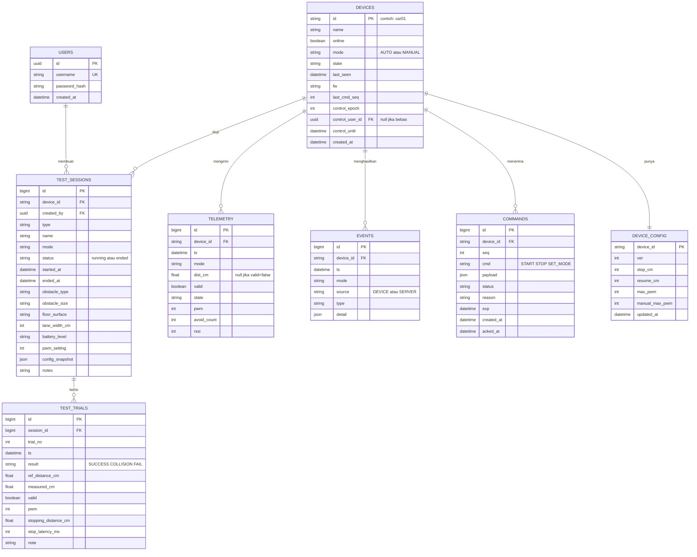

# Skema Database (PostgreSQL)

Sumber kebenaran: migrasi Prisma (`backend/prisma`). File ini WAJIB diperbarui setiap ada migrasi.

## ERD

## Tabel

### users
| Kolom | Tipe | Catatan |
|---|---|---|
| id | uuid PK | |
| username | text unique | |
| password_hash | text | argon2/bcrypt, jangan simpan password asli |
| created_at | timestamptz | default now() |

### devices
| Kolom | Tipe | Catatan |
|---|---|---|
| id | text PK | `car01` |
| name | text | |
| online | boolean | dari status/LWT/heartbeat |
| mode | text | `AUTO|MANUAL`, status terakhir dari telemetri |
| state | text | status terakhir dari telemetri |
| last_seen | timestamptz null | |
| fw | text null | |
| last_cmd_seq | int | pembuatan `seq` perintah secara atomik |
| control_epoch | int | menjadi `sid` drive; naik tiap kunci kendali baru; tidak reset |
| control_user_id | uuid null FK users | pemegang kunci kendali |
| control_until | timestamptz null | kunci kedaluwarsa |
| created_at | timestamptz | |

### telemetry
| Kolom | Tipe | Catatan |
|---|---|---|
| id | bigserial PK | |
| device_id | text FK | |
| ts | timestamptz | dari payload, atau waktu terima jika `ts=0` |
| mode | text | `AUTO|MANUAL` |
| dist_cm | real null | null jika tidak valid |
| valid | boolean | |
| state | text | STOP/MAJU/PINDAI/BELOK |
| pwm | smallint | 0..255 |
| avoid_count | int | |
| rssi | smallint null | |

Index: `(device_id, ts DESC)`, `(device_id, mode, ts DESC)`.

### events
| Kolom | Tipe | Catatan |
|---|---|---|
| id | bigserial PK | |
| device_id | text FK | |
| ts | timestamptz | |
| mode | text null | null untuk event server jika tidak diketahui |
| source | text | `DEVICE|SERVER` |
| type | text | STOP/MAJU/PINDAI/BELOK/BOOT/AVOID_DONE/SENSOR_FAIL/STOP_BUTTON/CMD_REJECTED/MODE_CHANGE/MANUAL_BLOCKED/MANUAL_TIMEOUT/DEVICE_ONLINE/DEVICE_OFFLINE |
| detail | jsonb | default `{}` |

Index: `(device_id, ts DESC)`, `(device_id, type, ts DESC)`.

### commands
| Kolom | Tipe | Catatan |
|---|---|---|
| id | bigserial PK | |
| device_id | text FK | |
| seq | int | unique per device |
| cmd | text | START/STOP/SET_MODE |
| payload | jsonb null | mis. `{"mode":"MANUAL"}` |
| status | text | pending/acked/rejected/expired |
| reason | text null | alasan penolakan dari ack |
| exp | timestamptz | |
| created_at | timestamptz | |
| acked_at | timestamptz null | latensi = acked_at − created_at |

Unique: `(device_id, seq)`. Index: `(device_id, created_at DESC)`.

### device_config
| Kolom | Tipe | Catatan |
|---|---|---|
| device_id | text PK/FK | |
| ver | int | naik tiap perubahan |
| stop_cm | int | 15..100 |
| resume_cm | int | stop_cm+3..150 |
| max_pwm | int | 80..255 |
| manual_max_pwm | int | 80..180 dan ≤ max_pwm |
| updated_at | timestamptz | |

Default awal: `stop_cm=25`, `resume_cm=30`, `max_pwm=200`, `manual_max_pwm=150`.

### test_sessions
| Kolom | Tipe | Catatan |
|---|---|---|
| id | bigserial PK | |
| device_id | text FK | |
| created_by | uuid FK users | |
| type | text | SENSOR/PENGHINDARAN/JARAK_BERHENTI/DAYA/KONEKSI_PUTUS/STOP |
| name | text | |
| mode | text | mode saat sesi dibuat; keberhasilan penghindaran hanya dari AUTO |
| status | text | running/ended; satu `running` per device |
| started_at | timestamptz | |
| ended_at | timestamptz null | |
| obstacle_type, obstacle_size, floor_surface | text null | metadata uji |
| lane_width_cm | int null | |
| battery_level | text null | catatan manual (mis. "penuh", "7.6V") |
| pwm_setting | int null | |
| config_snapshot | jsonb | `{ver, stop_cm, resume_cm, max_pwm, manual_max_pwm}` saat sesi dibuat |
| notes | text null | |

Index: `(device_id, started_at DESC)`, `(device_id, status)`.
Unique parsial: satu sesi `running` per `device_id`.

### test_trials
| Kolom | Tipe | Catatan |
|---|---|---|
| id | bigserial PK | |
| session_id | bigint FK test_sessions (on delete cascade) | |
| trial_no | int | urutan dalam sesi |
| ts | timestamptz | |
| result | text null | SUCCESS/COLLISION/FAIL |
| ref_distance_cm | real null | uji sensor (penggaris) |
| measured_cm | real null | diambil dari telemetri terbaru |
| valid | boolean null | validitas pembacaan |
| pwm | smallint null | uji jarak berhenti |
| stopping_distance_cm | real null | uji jarak berhenti |
| stop_latency_ms | int null | uji STOP |
| note | text null | |

Index: `(session_id, trial_no)`.

## Aturan penyimpanan
**Sampling telemetri** (jangan simpan tiap pesan):
- Simpan maksimum 1 baris per 2 detik per device, DAN
- selalu simpan saat `state`, `mode`, atau `valid` berubah.
- Data realtime ke FE tidak disampling.
- Persentase waktu per state memakai event transisi (akurat), bukan telemetri (perkiraan).

**Events**: simpan semua, termasuk event server (`DEVICE_ONLINE/OFFLINE`).

**Retention** (job harian):
- `telemetry` > 14 hari, `events` > 90 hari, `commands` > 30 hari dihapus,
  **KECUALI** baris yang berada di rentang waktu (`started_at`..`ended_at`, atau sampai sekarang jika masih running) sebuah `test_sessions`.
- `test_sessions` dan `test_trials` tidak dihapus otomatis (bukti laporan).

**Offline detection**: job tiap 5 detik menandai `online=false` jika `last_seen` > 15 detik lalu, membuat event `DEVICE_OFFLINE`.
Saat pesan kembali diterima: `online=true` dan event `DEVICE_ONLINE`.

**Kunci kendali**: job tiap 2 detik mengosongkan `control_user_id/control_until` yang kedaluwarsa dan menjadwalkan `drive S` best effort.

**Analisis**: gunakan query agregasi (`date_trunc`, `percentile_cont`, window function `lead()` untuk durasi antar event).
Tambahkan index sesuai hasil `EXPLAIN` jika lambat.